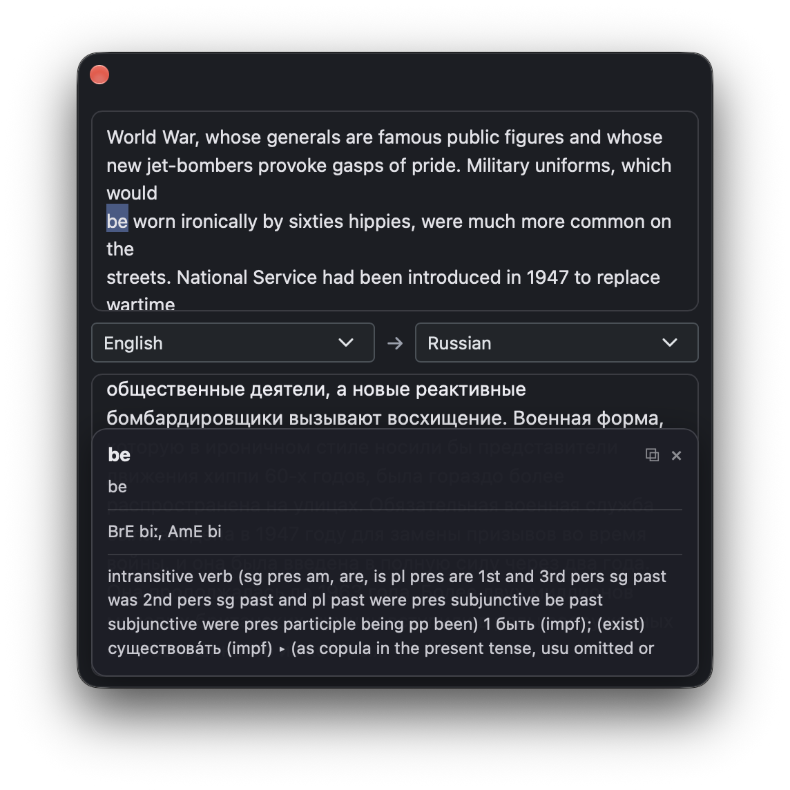

# macos-translate

A local translator for macOS: select text, hit "Translate", and a small window
appears next to the cursor where the translation is typed out token by token.
Hover a word to see its entry from the macOS system dictionary. Everything runs
offline — nothing leaves your machine.



- **Model:** Google TranslateGemma 4B, 8-bit MLX quant (~4 GB)
- **Languages:** 295 (225 bidirectional + 70 English-only targets)
- **Language detection:** lingua-language-detector (automatic)
- **Dictionary:** macOS system dictionaries (the ones in Dictionary.app)
- **Memory:** the model lives in a subprocess and is **unloaded after 10 minutes of inactivity**

## How it works

```
Text selection
   │  a Quick Action writes the text to a file and opens macos-translate://
   ▼
MacOSTranslate.app — native shell (Swift, no Dock icon)
   │  NSPanel + WKWebView; the UI is ONE minified index.html embedded in
   │  the bundle (TypeScript + Bootstrap, built by Vite), served via app://
   ▼
WebSocket → FastAPI gateway (port 8765, managed by launchd)
   │  pushes new selections, streams translation tokens
   ▼
worker.py subprocess — TranslateGemma via MLX (~4 GB, unloaded when idle)
```

Repo: https://github.com/blackwithwhite666/macos-translate

## Installation

Requirements: an Apple Silicon Mac, macOS 13+, [uv](https://docs.astral.sh/uv/),
Node.js (to build the UI), and Xcode Command Line Tools (`xcode-select --install`).

```bash
git clone https://github.com/blackwithwhite666/macos-translate.git
cd macos-translate

# 1) Python dependencies for the server
cd server && uv sync && cd ..

# 2) Build the app (UI + Swift; result: app/build/MacOSTranslate.app)
app/build.sh

# 3) Translation service: starts at login, auto-restarts, loads the model on demand
scripts/install-launchd.sh

# 4) Launch the app
open app/build/MacOSTranslate.app
```

On the first translation the model is downloaded from Hugging Face (3.9 GB)
into `~/.cache/huggingface`. The first translation takes a couple of minutes;
after that, a cold model load is ~5–10 s and a warm one translates in 1–3 s.

> You can copy the app to `/Applications` or `~/Applications` — it is
> self-contained; the server is only needed for translations.

## Automation: translate the selected text

### Quick Action (context menu + hotkey)

1. Open **Automator** → File → New → **Quick Action**
2. At the top set: "Workflow receives selected **text** in **any application**"
3. Add the **Run Shell Script** action:
   - Shell: `/bin/zsh`, "Pass input": **to stdin**
   - content — one line:
     ```bash
     ~/projects/macos-translate/scripts/quick-action.sh "$@"
     ```
4. Save it as **"Translate"**

Test from the terminal:

```bash
echo "Hello, world" | ~/projects/macos-translate/scripts/quick-action.sh
```

### Hotkey

System Settings → Keyboard → Keyboard Shortcuts → **Services** → "Translate" →
Add Shortcut. A free combination: **⌥⌘E** (⌥⌘R and ⌥⌘U are free too).

Once configured: select text → right-click → Services → "Translate" (or ⌥⌘E)
→ the panel with the translation appears near the cursor.

The default target language is Russian; change it in the panel's selector —
the choice is remembered. You can also pass a language to the script:
`quick-action.sh English`.

## Usage

- **Panel**: click outside it and it hides; Esc hides it too; drag it by the
  titlebar. The translation is typed out with a blinking caret; long texts
  scroll inside their boxes
- **Dictionary**: put the pointer on a word in the source text or the
  translation — a card with the dictionary entry appears at the bottom. It uses
  your active dictionaries (manage them in Dictionary.app). The word is looked
  up in the context of the phrase, so inflected forms are found ("went" → "go")
- **Source language**: "Auto" (lingua) — after detection the selector shows the
  detected language; picking a language manually restarts the translation
- **Copy**: ⧉ in the dictionary card, or just select and Cmd+C

## Logs

- `logs/translations.jsonl` — what was asked to translate and what came back:
  input, output, languages, tokens, duration (`tail -f logs/translations.jsonl`)
- `logs/server.log` — lifecycle: model load/unload, errors

## Configuration

Environment variables of the LaunchAgent
(`~/Library/LaunchAgents/local.macos-translate.server.plist`):

| Variable | Default | Meaning |
|---|---|---|
| `MT_IDLE_TIMEOUT` | `600` | seconds of inactivity before the model is unloaded |
| `MT_DEFAULT_TARGET` | `Russian` | default target language |

Ports: the gateway listens on `127.0.0.1:8765` (HTTP + SSE + WebSocket).
The UI itself listens on nothing.

After editing the plist:
`launchctl kickstart -k gui/$(id -u)/local.macos-translate.server`.

## Development

```bash
cd server
uv run pytest                          # tests (fake worker, no model needed)
uv run ruff check .                    # lint
uv run ty check gateway.py worker.py   # types

cd ../frontend
npm run typecheck                      # TypeScript

cd ../app
./build.sh                             # rebuild UI + Swift + bundle
```

Manual translation check without the UI:

```bash
curl -N -X POST http://127.0.0.1:8765/translate \
  -H 'Content-Type: application/json' \
  -d '{"text":"Hello, how are you?","src":"auto","tgt":"Russian"}'
```

### Layout

```
app/        Swift: NSPanel + WKWebView, app:// scheme, dictionary bridge (DCS)
frontend/   TypeScript UI (Vite → one index.html bundled into the app)
server/     FastAPI gateway + worker.py with the model, tests
scripts/    quick-action.sh, install/uninstall-launchd.sh, gen-languages.py
logs/       translations.jsonl, server.log
```

## Stopping and removal

```bash
scripts/stop-servers.sh       # stop the servers once
scripts/uninstall-launchd.sh  # remove the LaunchAgent
# the app: just close it / delete MacOSTranslate.app
```

## License

The code is MIT. The TranslateGemma model is subject to Google's Gemma Terms of
Use (downloaded separately on first run).
